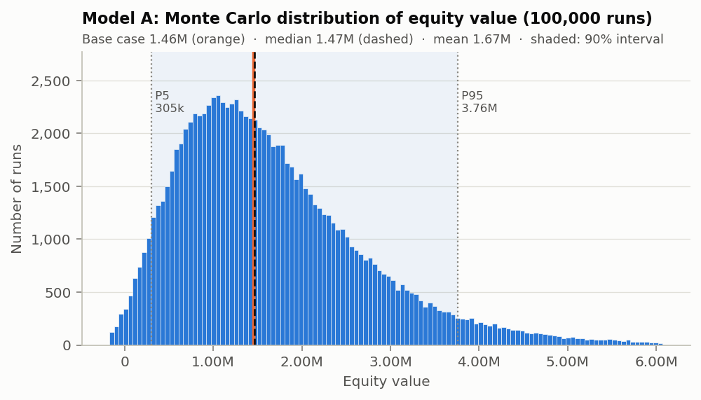
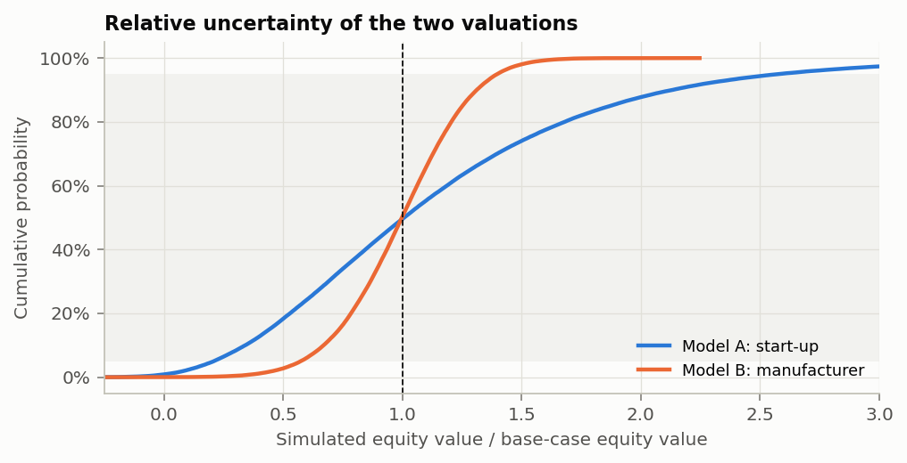
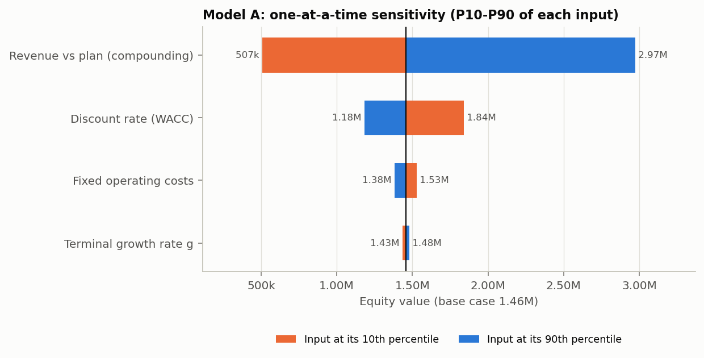
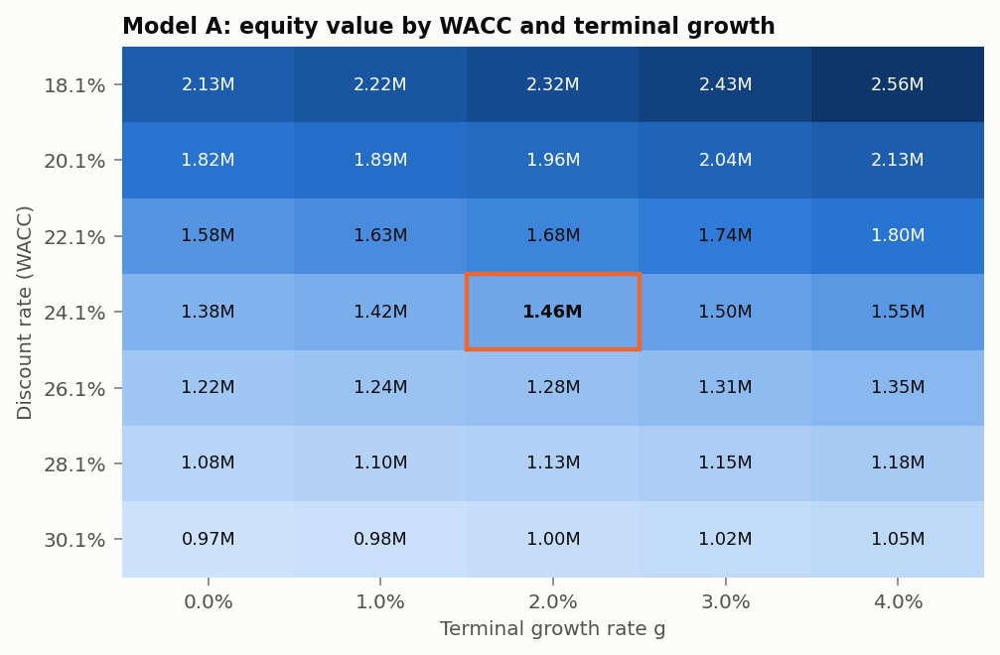
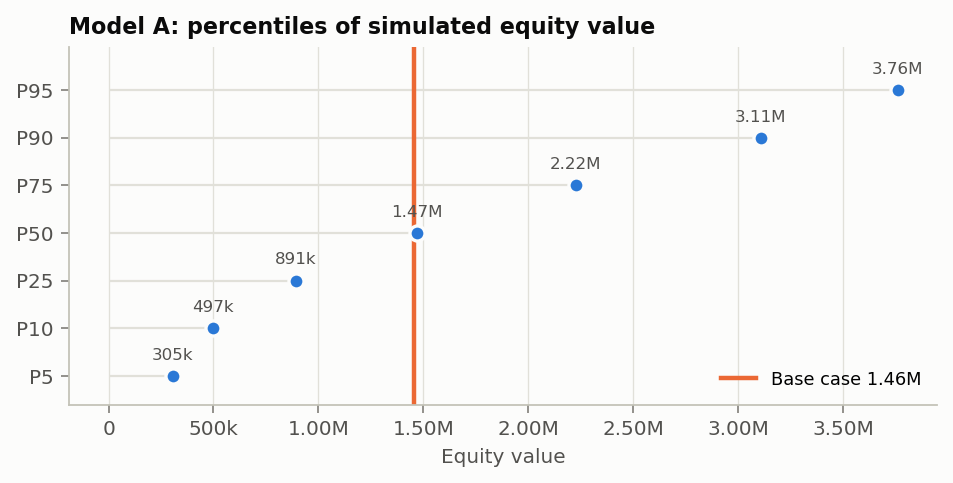
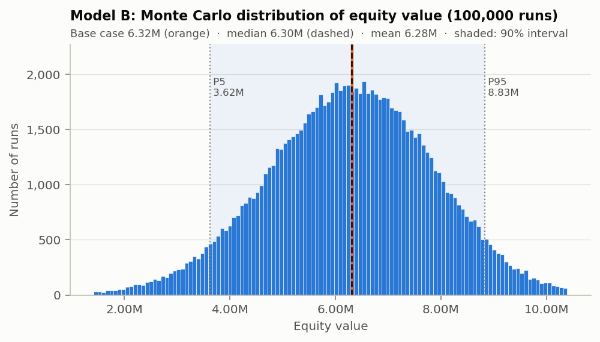
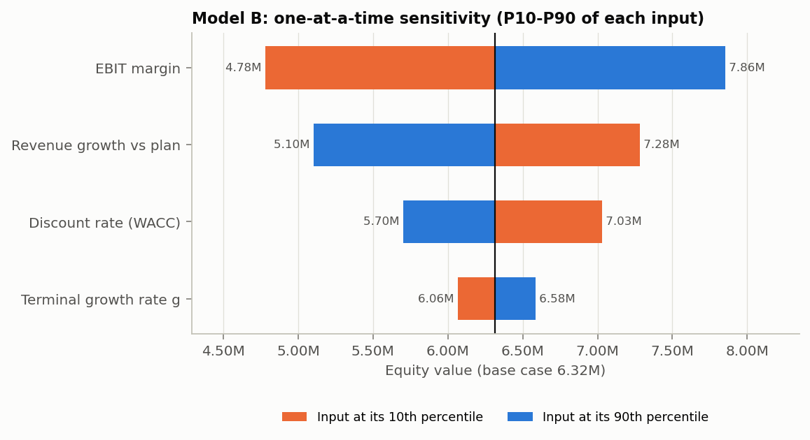
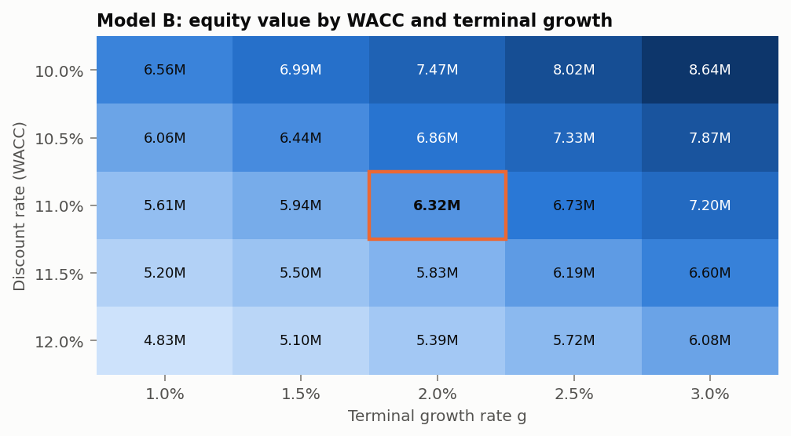

# Company Valuation Using DCF and Monte Carlo Simulation

[](https://github.com/milansta6/dcf-monte-carlo-valuation/actions/workflows/ci.yml)


The thesis and its reproducible Python code.

> **Company Valuation Using the Discounted Cash Flow Method and Monte Carlo Simulation**
> Master's thesis · **Milan Stamenović**
> Master in Computer Science – Computational Finance
> School of Computing, Union University, Belgrade · 2026
> Mentor: **Prof. dr Branko Urošević**
>
> 📄 [Read the thesis (PDF)](thesis/Master_Thesis_Milan_Stamenovic_public.pdf)

## Abstract

What is a company worth, and how far can that number be trusted? This thesis
values two very different Serbian companies with the discounted cash flow
method, following Aswath Damodaran's framework. Then it asks how reliable each
valuation is.

The first company is a pre-revenue software start-up co-founded by the author.
The second is an established furniture manufacturer with several hundred
employees, valued in professional practice and presented anonymously. Both models build
the discount rate from the CAPM plus country and company-specific risk
premiums, project free cash flow, and add a Gordon-growth terminal value. The single-number results
are then replaced by distributions: a Monte Carlo simulation recomputes each
model 100,000 times with uncertain growth, margins or costs, discount rate and
terminal growth.

The base cases are EUR 1.46 million for the start-up and EUR 7.51 million
for the manufacturer, but the two are not equally reliable. The start-up's 90 %
interval spans more than a factor of twelve (coefficient of variation 0.66). The
manufacturer's spans a factor of two and a half (0.25). The simulation also
identifies the drivers of value: customer acquisition for the start-up, and the
operating margin for the manufacturer, where faster growth actually *destroys*
value because the working capital it requires earns less than the cost of
capital. The conclusion is that DCF works in an emerging market like Serbia,
provided the point estimate is always reported together with its uncertainty.

## DCF and Monte Carlo in two sentences each

**Discounted cash flow (DCF).** A company is worth the cash it will generate in
the future, converted into today's money with a discount rate that reflects how
risky that cash is. You forecast free cash flow for a few years, add a
*terminal value* for everything afterwards, and discount it all to the present.

**Monte Carlo simulation.** Instead of plugging one guess into each uncertain
assumption, you give each assumption a probability distribution and recompute
the model thousands of times with random draws. The result is a full
distribution of possible values, with percentiles, probabilities and a ranking
of which assumptions matter most.

## Key results

| | Model A: software start-up | Model B: furniture manufacturer |
|---|---|---|
| WACC | 24.1 % | 11.0 % |
| Equity value, base case | **EUR 1.46 m** | **EUR 7.51 m** |
| Terminal value / enterprise value | 66.5 % | 156 % |
| Monte Carlo mean / median | EUR 1.67 m / 1.47 m | EUR 7.46 m / 7.50 m |
| 90 % interval (P5–P95) | EUR 0.30 – 3.76 m | EUR 4.28 – 10.52 m |
| …relative to the base case | 21 % – 258 % | 57 % – 140 % |
| Coefficient of variation | 0.66 | 0.25 |
| Main driver (Spearman ρ) | revenue vs plan (+0.96) | EBIT margin (+0.75) |
| Second driver | WACC (−0.24) | revenue growth (**−0.52**) |

*Thesis figures. The repository reproduces Model A to the euro and Model B's ratios, see [Reproducing the thesis](#reproducing-the-thesis).*





<details>
<summary>More charts: tornado diagrams, sensitivity tables, percentiles</summary>








Company B charts are in scaled euros (see the note below).
</details>

## How the code maps to the thesis

| Thesis | Topic | Code |
|---|---|---|
| Ch. 1.3, eqs. 1–3 | Free cash flow, mid-year discounting, Gordon terminal value, equity bridge | [`dcf.py`](src/dcf_valuation/dcf.py): `project`, `discount`, `base_case` |
| Ch. 2, eqs. 4–7 | CAPM build-up, Hamada relevering, cost of debt, WACC | [`wacc.py`](src/dcf_valuation/wacc.py) |
| Ch. 3.2 | Sensitivity tables, scenario grids, tornado | [`analysis.py`](src/dcf_valuation/analysis.py) |
| Ch. 3.3–3.4 | Vectorised Monte Carlo simulation, fixed seed | [`montecarlo.py`](src/dcf_valuation/montecarlo.py) |
| Ch. 4 (Tables 4–9) | Model A: pre-revenue software start-up | [`examples/startup.yaml`](examples/startup.yaml), [notebook 1](notebooks/01_startup_valuation.ipynb) |
| Ch. 5 (Tables 10–16) | Model B: established manufacturer (anonymised) | [`examples/company_b.yaml`](examples/company_b.yaml), [notebook 2](notebooks/02_company_b_valuation.ipynb) |
| Ch. 6 (Fig. 15, Table 17) | Comparison of the two valuations | [`thesis.py`](src/dcf_valuation/thesis.py), `plots.compare_cdf` |
| Appendix A | Original simulation code | Re-implemented and tested in `src/dcf_valuation/` |

Every input in the YAML files carries a comment naming the thesis table it comes
from. Both models use the thesis's own conventions. Tax is applied to EBIT in every year.
Model A discounts the terminal value one year further than Model B. Model A's
simulation builds the terminal cash flow as 1.03 × FCF₂₀₃₁. The thesis
discusses each of these choices.

## How to run

```bash
git clone https://github.com/milansta6/dcf-monte-carlo-valuation.git
cd dcf-monte-carlo-valuation
python -m venv .venv && source .venv/bin/activate   # Windows: .venv\Scripts\activate
pip install -e ".[dev]"
```

```bash
# value one company: prints the valuation and saves charts to output/
python -m dcf_valuation --config examples/startup.yaml

# fewer runs, another seed, another output folder
python -m dcf_valuation --config examples/company_b.yaml --runs 20000 --seed 1 --out my_charts

# reproduce the thesis and compare every key number
python scripts/reproduce_thesis.py --out docs/images

# tests and linting
pytest
ruff check .
```

**Notebooks:** `jupyter lab notebooks/` walks through each valuation step by
step, in plain language, for readers without a finance background.

**Interactive app** (optional): `pip install -e ".[app]"` and then `streamlit run app.py`.
Move sliders for the risk-free rate, risk premiums, beta, terminal growth and
the Monte Carlo volatilities, and watch the distribution change.

To value your own company, copy `examples/startup.yaml`, change the numbers and
run the CLI on it. Two operating models are supported: `cost_build_up`
(revenue − variable − fixed costs) and `ebit_margin` (revenue × margin).
Working capital can be given as annual `flows` or closing `levels`.

## Reproducing the thesis

`python scripts/reproduce_thesis.py` recomputes both examples and prints a
table of **80 checks** against the thesis. Each check shows the thesis value,
the computed value and pass/fail. `pytest` runs the same checks in CI.

* **Model A** is reproduced in euros. The deterministic values in Tables 6
  and 7 match to the euro. The Monte Carlo statistics in Table 9 also match exactly,
  because the code replays the thesis's random stream: seed `20260927`, Model A
  drawn first, then Model B continuing the same stream.
* **Model B** is checked through scale-free ratios: WACC, TV share,
  percentiles, standard deviation and grid extremes relative to the base case,
  probabilities, and Spearman correlations. They agree within 1 %. The small gap is the
  rounding of the anonymised inputs.
* Run with your own seed (`--seed`), or Model B on its own, and the results differ from
  the thesis only by sampling error, as expected. The tests check that too.

**Known difference.** Table 14 also reports a 343-scenario grid that varies
the final-year EBIT margin. Its mean and median are reproduced, but its spread
is not (standard deviation 0.57 m vs 0.58 m in the thesis). The thesis does not
specify exactly how the spreadsheet varied that margin, so the code reproduces
only the fully specified 49-scenario WACC × g grid, which matches exactly.

### About Company B

Company B is a real company and a confidential client. It is anonymised here.
Every euro amount in [`examples/company_b.yaml`](examples/company_b.yaml) is the thesis figure
multiplied by an undisclosed factor and rounded to EUR 10,000. Rates,
percentages, distributions and the model logic are unchanged, so every ratio
and every conclusion carries over. Only the euro levels differ from the thesis.
For the same reason, the public PDF shows Company B's amounts rounded to EUR millions.

## Citation

If you use this code or refer to the thesis, please cite it (see [`CITATION.cff`](CITATION.cff)):

```bibtex
@mastersthesis{stamenovic2026dcf,
  author = {Stamenović, Milan},
  title  = {Company Valuation Using the Discounted Cash Flow Method and Monte Carlo Simulation},
  school = {Union University, School of Computing},
  address = {Belgrade},
  year   = {2026},
  type   = {Master's thesis (Computational Finance)},
  note   = {Mentor: Prof. dr Branko Urošević}
}
```

## License

* **Code** (everything outside `thesis/`): [MIT](LICENSE).
* **Thesis** (`thesis/`): © 2026 Milan Stamenović, all rights reserved. It is
  shared for reading only; see [`thesis/README.md`](thesis/README.md).

Market data in the examples come from Aswath Damodaran's public datasets, Kroll,
the National Bank of Serbia and public bond market data, as cited in the thesis.
